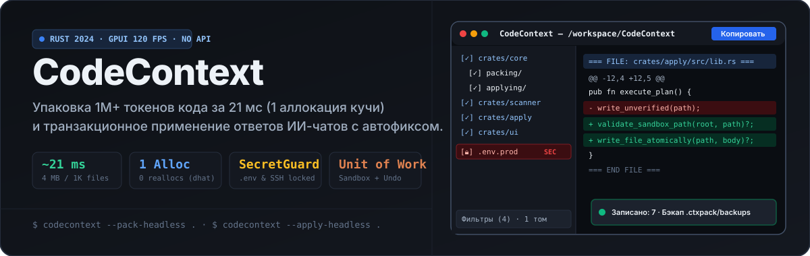
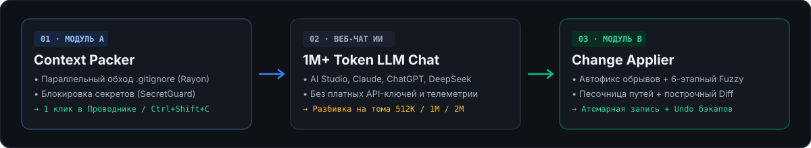

<div align="center">



<br />

**[🇷🇺 Русский](./README.md)** · **[🇬🇧 English](./README.en.md)** · **[📋 Changelog (RU)](./CHANGELOG.md)** · **[📋 Changelog (EN)](./CHANGELOG.en.md)** · **[🏛️ Architecture & DDD](./docs/README.md)**

[](https://github.com/NIKIRIKI7/CodeContext/actions/workflows/ci.yml)
[](https://github.com/NIKIRIKI7/CodeContext/releases)
[](./Cargo.toml)
[](./crates/ui)
[](./LICENSE-MIT)

</div>

---

## 01 · What is CodeContext and Why It Exists

Developers increasingly rely on free web AI chats with massive context windows (**1M–2M+ tokens**: Google AI Studio, Claude, ChatGPT, DeepSeek, Qwen) to refactor entire codebases without paying per-token API fees.

However, doing this manually breaks developer flow:
1. **Slow file selection & secret leaks:** Manually copying dozens of files takes minutes, and accidentally including `.env`, `id_rsa`, or `*.pem` exposes credentials.
2. **Browser tab freezes on multi-megabyte prompts:** Pasting 4 MB of raw source code with comments and build artifacts (`target/`, `node_modules/`) lags web chat inputs.
3. **Truncated and inconsistent AI responses:** Web chats prepend conversational chatter, cut off code mid-file when hitting output token limits, and mix formats (`Markdown`, `SEARCH / REPLACE`, `Unified Diff`).

**CodeContext** solves both halves of the loop deterministically, locally, and instantaneously — **with zero built-in LLMs, zero cloud accounts, and zero telemetry**:

<p align="center">
  
</p>

---

## 02 · Why CodeContext (Engineering Proof)

Every performance and safety claim is enforced by automated CI fitness functions (`dhat`, `divan`, `proptest`, `architecture.rs`):

| Capability | Engineering Implementation | Verification in Code & CI |
| :--- | :--- | :--- |
| **Ultra-fast packing (`~21 ms` for 4 MB)** | Two-phase parallel walk (`ignore` + `rayon`) and 8 KB SIMD binary probe (`memchr`). | `crates/scanner/benches/pack_throughput.rs` (SLA `< 1 s`, actual `~21 ms` on 1,000 files) |
| **Strictly 1 Heap Allocation (`0 Reallocs`)** | Exact byte capacity pre-calculation (`calculate_exact_capacity`) prior to string assembly, including streaming minification and `CRLF → LF`. | `crates/scanner/tests/heap_allocations.rs` (`dhat::assert_eq!(delta_blocks, 1)`) |
| **Zero Secret Leaks (`SecretGuard`)** | Rule chain blocks `.env*`, SSH keys, certificates, and `PRIVATE KEY` content headers; strips secret unlock attempts from untrusted `.ctxpack.json` (Scenario A3). | `crates/core/src/packing/services/secret_guard.rs` |
| **Zed-Grade 6-Stage Fuzzy Patcher** | Chain of `Exact` → `LineEnding` → `Trimmed` → `SyntaxNormalized` → `Ellipsis (...)` → `Sørensen–Dice Bigram Similarity` with strong boundary anchors. | `crates/apply/src/patching/fuzzy_matcher.rs` |
| **Transactional Safety & `Sandbox`** | Blocks path traversal (`../`, `C:\`, UNC, NTFS ADS, external symlinks), writes via temp file + `sync_all` + atomic `rename`, and supports 1-click **Undo** from `.ctxpack/backups/`. | `crates/apply/tests/proptest_invariants.rs` (1,500 `proptest` fuzzing cases) |
| **120 FPS GPU Interface (`GPUI`)** | Virtualized 50,000-file tree (`FlatTreeProjection`, `< 0.5 ms` directory checkbox toggle) and zero-allocation viewport slicing for multi-MB text (`VirtualTextBuffer`). | `crates/ui/tests/ui_state_and_projections.rs` |

---

## 03 · Implemented Features

### Module A — Context Packing (`packing`)
- [x] Full hierarchical `.gitignore` and `.ignore` support + automatic pruning of heavy directories (`node_modules`, `target`, `.git`, `dist`, `build`, `.venv`).
- [x] 3-layer cascading configuration: `Built-in Defaults` → Global user profile → Project `.ctxpack.json` (with automatic `v0 → v1` schema migration and `1 MB` file size guard).
- [x] Language-aware streaming code minification (single-line collapse for Rust/TS/Go/C++ and indentation-preserving comment stripping for Python/YAML/Shell/TOML).
- [x] On-the-fly AVX2/SIMD `CRLF → LF` line-ending normalization with zero intermediate allocations.
- [x] Multi-volume splitting (`Chunker`: Single volume / `512 KB` / `1 MB` / `2 MB`) without splitting individual files.
- [x] Optional `=== PROJECT TREE ===` ASCII header and real-time byte, line, and token estimation.

### Module B — Change Applying (`applying`)
- [x] Multi-format parser chain (`FORMAT_EXTRACTOR_CHAIN`): canonical `=== FILE: ... ===` blocks, Markdown fenced blocks with heading or first-line comment paths (`// filepath: ...`), `<<<<<<< SEARCH ... >>>>>>> REPLACE` blocks, `Unified Diff` patches (`--- a/... +++ b/...`), and file creation/deletion directives (`=== CREATE FILE: ... ===`, `=== DELETE FILE: ... ===`).
- [x] Deterministic **Autofix**: strips conversational preambles, unwraps outer ```` ```markdown ```` fences, and closes truncated blocks with a `TruncatedWarning` badge.
- [x] Line-by-line `Unified Diff` preview with status indicators (`Ready`, `TruncatedWarning`, `SearchBlockConflict`, `BlockedBySandbox`) and dirty `git status` detection.
- [x] Automatic backup snapshots in `.ctxpack/backups/<timestamp>/manifest.json` with instant **Undo**.

### OS Integration & Lifecycle (`platform` & `ui`)
- [x] **Cascading OS Context Menu** with 3 actions (*"Copy Context (with .gitignore)"*, *"Apply AI Patch (Autofix)"*, *"Open in GUI"*) for **Windows Explorer** (`HKCU\Software\Classes` registry with `%V\.` escaping protection), **macOS Finder** (`~/Library/Services/CodeContext Copy.workflow`), and **Linux** (KDE Dolphin `kio/servicemenus`, Cinnamon Nemo, GNOME Nautilus).
- [x] **Single-Instance IPC** over OS local sockets/named pipes using a zero-copy binary `CC\x01` wire protocol with automatic stale socket recovery.
- [x] **Global Hotkey** (`Ctrl+Shift+C` / `⌘⇧C`) with interactive key recording and Wayland display server detection.
- [x] **Self-Installer & Auto-Updater (`SystemUpdater`)** supporting `Stable` / `Beta` / `Alpha` channels with SHA-256 and cryptographic signature verification (`releases-index.json`).
- [x] Instant runtime switching between **Dark / Light** themes and **Russian / English** UI locales.

---

## 04 · Download & Installation

Pre-built PGO + Fat LTO binaries and native OS installers are published on **[GitHub Releases](https://github.com/NIKIRIKI7/CodeContext/releases/latest)**:

| Platform & Architecture | Available Packages & Installers | Quick Install |
| :--- | :--- | :--- |
| **Windows x64** (`x86_64-pc-windows-msvc`) | `.msi` (WiX installer), `.zip`, `.7z`, portable `.exe` | Run the `.msi` (sets `PATH` & Explorer context menu) or run `codecontext.exe --self-install` |
| **Windows ARM64** (`aarch64-pc-windows-msvc`) | `.zip`, `.7z`, portable `.exe` | Extract archive and run `codecontext.exe --self-install` |
| **macOS Apple Silicon** (`M1 / M2 / M3 / M4`) | `.dmg`, `.pkg`, `.zip`, `.tar.gz` | Drag `CodeContext.app` from `.dmg` to `/Applications` or install `.pkg` |
| **macOS Intel & Universal2** (`x86_64` / `universal`) | `.dmg`, `.pkg`, `.zip`, `.tar.gz` | Install `codecontext-universal-apple-darwin.dmg` |
| **Ubuntu / Debian / Mint / Pop!_OS** (`amd64` & `arm64`) | `.deb`, `.AppImage`, `.tar.gz`, `.tar.xz`, `.tar.zst` | `sudo dpkg -i codecontext-*-linux-gnu.deb` |
| **Fedora / RHEL / Rocky / openSUSE** (`x86_64` & `aarch64`) | `.rpm`, `.AppImage`, `.tar.gz`, `.tar.xz`, `.tar.zst` | `sudo rpm -Uvh codecontext-*-linux-gnu.rpm` |
| **Arch Linux / Manjaro / SteamOS** (`x86_64` & `aarch64`) | `.pkg.tar.zst`, `.AppImage`, `.tar.gz` | `sudo pacman -U codecontext-*-linux-gnu.pkg.tar.zst` |

---

## 05 · Building from Source

### 1. Prerequisites
Install the stable **Rust toolchain (1.88+ / Edition 2024)** via [rustup.rs](https://rustup.rs/).

- **Windows 10 / 11:** Visual Studio Build Tools (C++ workload) and bundled `rust-lld`.
- **macOS:** Xcode Command Line Tools (`xcode-select --install`).
- **Linux (Ubuntu / Debian):**
  ```bash
  sudo apt-get update && sudo apt-get install -y \
    build-essential binutils lld clang libclang-dev pkg-config \
    libxcb1-dev libxcb-render0-dev libxcb-shape0-dev libxcb-xfixes0-dev \
    libxkbcommon-dev libxkbcommon-x11-dev libwayland-dev libvulkan-dev \
    libfontconfig1-dev libfreetype6-dev libx11-dev libxcursor-dev libxi-dev
  ```

### 2. Compile & Verify

```bash
git clone https://github.com/NIKIRIKI7/CodeContext.git
cd CodeContext

# Compile maximally optimized release binary (Fat LTO, CGU=1, Strip)
cargo build --release --locked --package app

# Launch GPUI desktop application (via cargo alias `r`)
cargo r

# Run DDD architectural fitness tests and zero-reallocation heap check (dhat)
cargo test --package app --test architecture
cargo test --release --package scanner --test heap_allocations -- --test-threads=1
```

---

## 06 · CLI, Headless & GUI Reference

### A. Command-Line & Headless Fast-Path

```bash
# 1. Pack project into OS clipboard in headless mode (< 1 sec)
codecontext --pack-headless /path/to/project

# 2. Apply AI patch from clipboard in headless mode (with autofix & backup)
codecontext --apply-headless /path/to/project

# 3. Open specific project directory in GPUI window
codecontext --project /path/to/project

# 4. Register / unregister OS file manager context menu
codecontext --register-shell
codecontext --unregister-shell

# 5. Self-install binary to canonical user path & check for updates
codecontext --self-install
codecontext --check-update
codecontext --version
```

### B. GUI Keyboard Shortcuts

| Shortcut (Win/Linux · macOS) | Action |
| :--- | :--- |
| `Ctrl+Shift+C` · `⌘⇧C` | **Global Hotkey** (focus window / copy packed context / auto-read clipboard) |
| `Ctrl+O` · `⌘O` | Open project folder |
| `Ctrl+F` · `⌘F` | Interactive file tree search (`Backspace` / `Esc` to clear) |
| `F5` or `Ctrl+R` · `⌘R` | Rescan project file system |
| `Ctrl+V` · `⌘V` | Paste AI response from clipboard and run parser + autofix |
| `Ctrl+Enter` · `⌘↵` | Transactionally apply parsed file changes to disk |
| `Ctrl+Z` · `⌘Z` | Undo last apply from `.ctxpack/backups/` snapshot |

---

## License

Dual-licensed under **[MIT](./LICENSE-MIT) OR [Apache-2.0](./LICENSE-APACHE)**.